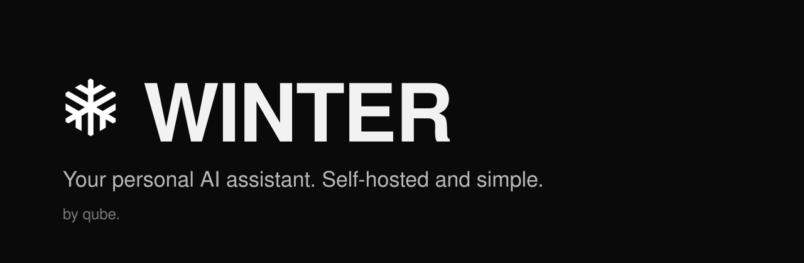
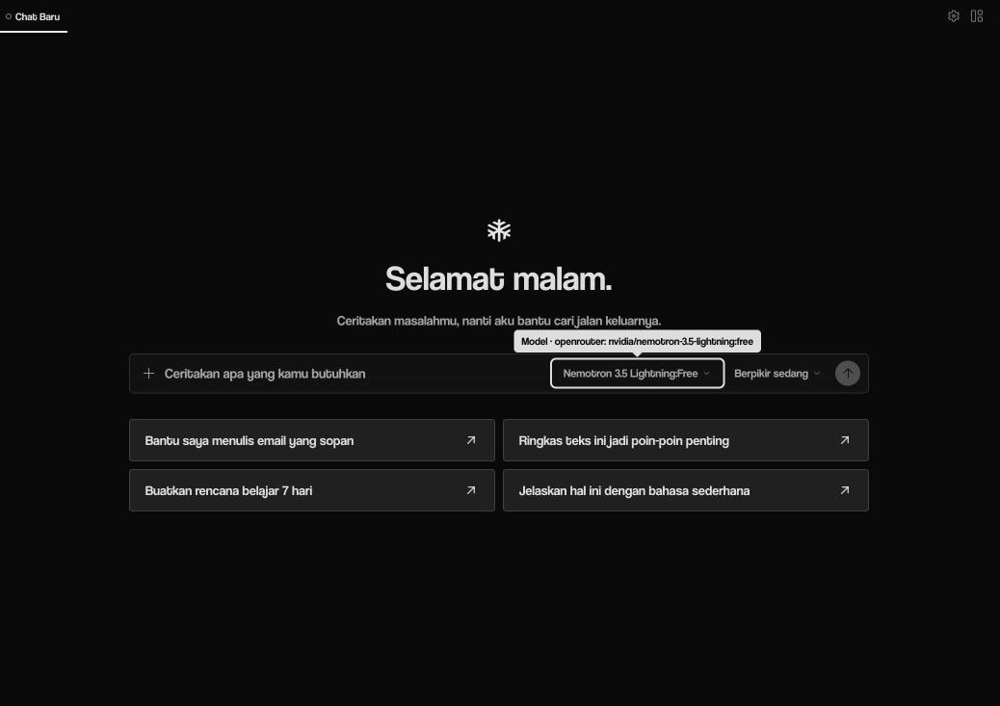

<p align="center">
  
</p>

<p align="center">
  <a href="LICENSE"></a>
  
  
</p>

<p align="center">
  <a href="#quick-start">Quick start</a> ·
  <a href="#features">Features</a> ·
  <a href="#invite-friends">Invite friends</a> ·
  <a href="#faq">FAQ</a>
</p>

<br>

<p align="center">
  
</p>

## Why WINTER

Most AI apps are built for people who already speak AI. WINTER is built for everyone else.

- **Just talk to it.** Open the app and type the way you would message a friend. Example prompts show what it can do.
- **Yours, on your machine.** WINTER runs in Docker on your own computer and keeps your history there. Messages go only to
  the model provider you choose.
- **Share it with friends.** They sign up, you approve, and they chat with your WINTER from their own browser.
- **Free to run.** Works with free models on OpenRouter out of the box; bring your own key for anything else.

## Features

| | |
| --- | --- |
| **Chat that remembers** | Memory across conversations, organised into projects. |
| **Gets things done** | Writes, summarises, plans and runs code in a sandbox. |
| **Learns your habits** | Turns repeated tasks into reusable skills. |
| **Works where you are** | Connect Telegram, WhatsApp and other chat apps. |
| **Runs on a schedule** | Daily briefings, reminders and recurring jobs. |
| **Simple or advanced** | A calm chat-first mode for everyone, a full workspace with terminal and files for power users. |
| **Developer friendly** | OpenAI-compatible API and MCP support. |

## Quick start

You need [Docker](https://docs.docker.com/get-docker/) and `python3`.

```bash
git clone https://github.com/rifqirizqullah1453-cell/winter.git
cd winter
scripts/setup.sh
```

The setup asks for a free [OpenRouter](https://openrouter.ai/keys) API key, a login password and, optionally, a Telegram bot.
When it finishes, open **http://127.0.0.1:9120** and sign in.

| Service | Address |
| --- | --- |
| Chat app | http://127.0.0.1:9120 |
| Admin dashboard | http://127.0.0.1:9119 |
| OpenAI-compatible API | http://127.0.0.1:8642 |

## Invite friends

Friends open the chat app and choose **Daftar** (Sign up). New accounts wait for you:

```bash
scripts/winter-users.sh approve <username>
```

Prefer Google sign-in? Set `GOOGLE_CLIENT_ID`, `GOOGLE_CLIENT_SECRET` and `WINTER_ALLOWED_EMAILS` in `.env`, then run
`docker compose up -d dashboard`.

## FAQ

**Are my friends' chats private from each other?**
No. Every account talks to the same WINTER and sees the same chat history, so invite only people you trust.


**Which language does it speak?**
The app opens in Bahasa Indonesia. Switch languages in Settings; WINTER replies in whatever language you write in.

**A reply failed with a 404.**
Free models on OpenRouter come and go. Pick another model from the message box, or change `model.default` in your config.

**Where are the voice buttons?**
Voice needs a speech-to-text provider. Configure one, then switch to Advanced mode in Settings.

**Why does the font look different from the screenshot?**
WINTER's typeface, Coolvetica, is not included for licensing reasons. Put `coolvetica-rg.otf`, `coolvetica-it.otf` and
`coolvetica-hv.otf` in `apps/desktop/public/fonts/` to use it; otherwise your system font is used.

## License

[MIT](LICENSE). See [NOTICE](NOTICE) for third-party attributions.

<p align="center"><sub>Made by qube.</sub></p>
